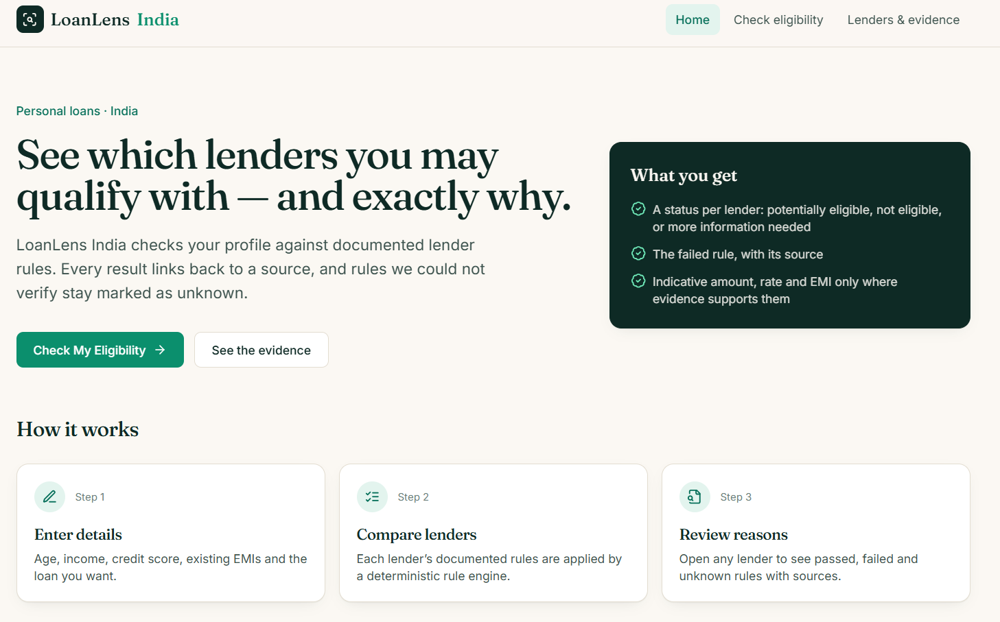
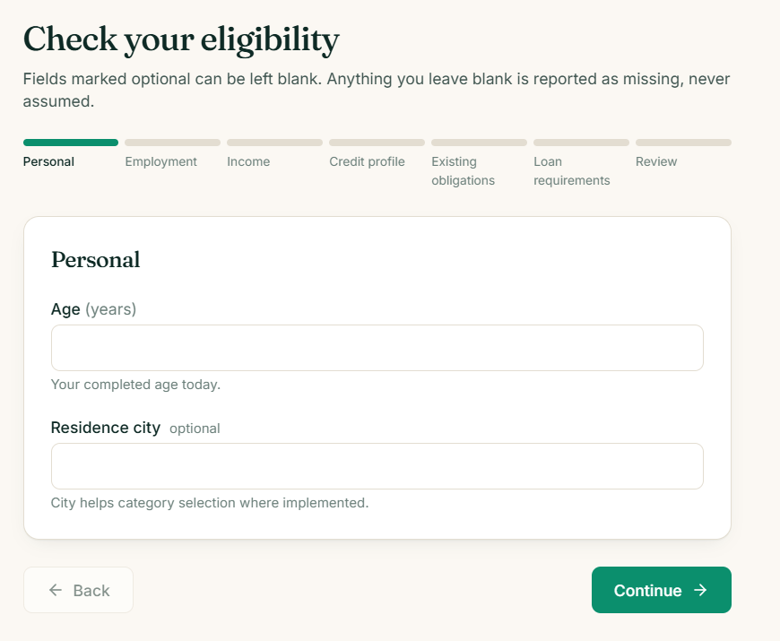
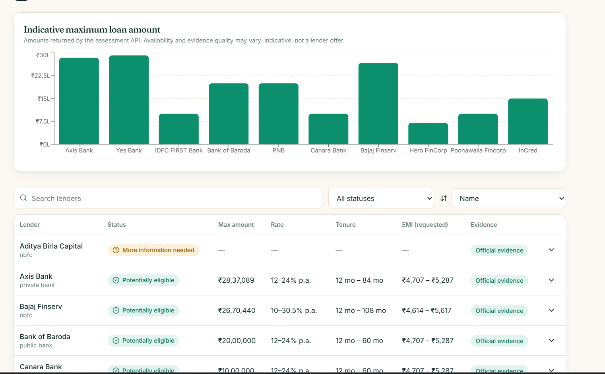
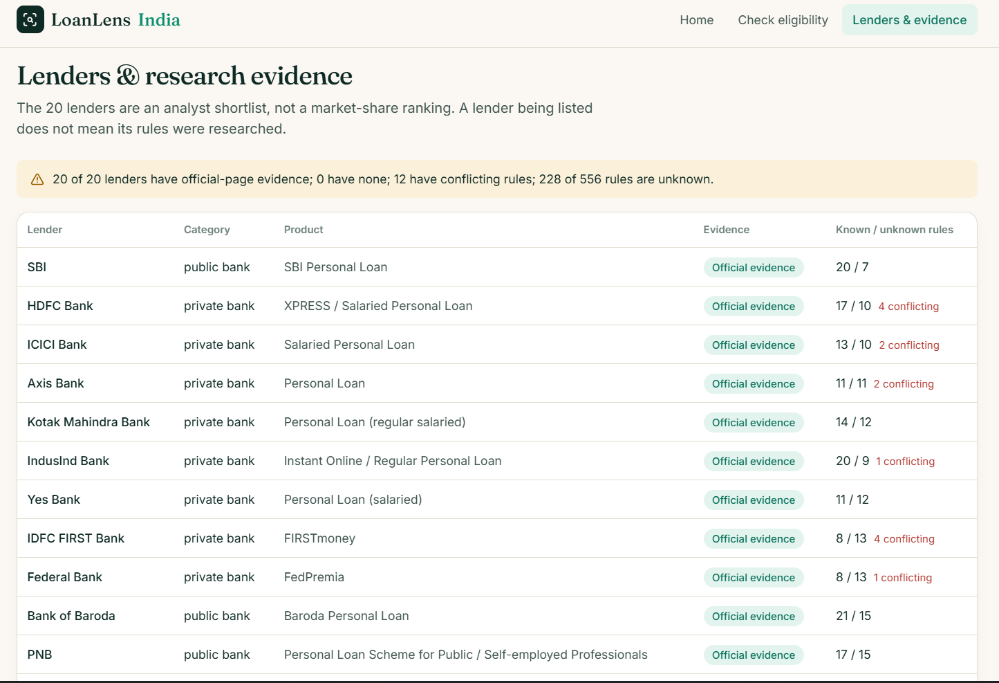

# LoanLens India — Personal Loan Eligibility Rules & Rule-Based Model

> **"Can I get a personal loan, and from whom?"**
> A public-source dataset of personal-loan eligibility rules for 20 Indian lenders, plus a rule-based (no ML) model that screens one applicant profile against all 20.

**Important:** this project gives an **indicative screening against publicly published rules**. It is **not** a bank approval, a loan offer, an approval probability or a personalised interest rate. Banks apply internal underwriting that is not public.

---

## Contents

1. [The problem](#1-the-problem)
2. [Scope](#2-scope)
3. [How I chose the 20 lenders](#3-how-i-chose-the-20-lenders)
4. [My approach](#4-my-approach)
5. [How I found rules that are not listed](#5-how-i-found-rules-that-are-not-listed)
6. [Input variables (datapoint set)](#6-input-variables-datapoint-set)
7. [Lender rule table](#7-lender-rule-table)
8. [The model](#8-the-model)
9. [Test profiles and outputs](#9-test-profiles-and-outputs)
10. [Assumptions](#10-assumptions)
11. [Insights](#11-insights)
12. [Limits of the model and known issues](#12-limits-of-the-model-and-known-issues)
13. [What I would add next](#13-what-i-would-add-next)
14. [Repository structure](#14-repository-structure)
15. [Setup and how to run](#15-setup-and-how-to-run)
16. [Demo mode](#16-demo-mode)
17. [Frontend screenshots](#17-frontend-screenshots)

---

## 1. The problem

Banks do not publish their full personal-loan eligibility rules. They publish some (minimum age, minimum salary, a CIBIL cut-off). The rest hides in calculators, FAQs, product terms, rate pages, RBI directions and comparison sites.

My job was to find the rules that decide eligibility, turn them into datapoints, and build a simple model that takes **one person's profile and returns a decision**.

## 2. Scope

| Requirement | What I did |
|---|---|
| Personal loans only | Only personal-loan products. Other loan types are excluded. |
| Top 20 lenders, with an explained choice | 20 lenders (banks + NBFCs). See [section 3](#3-how-i-chose-the-20-lenders). |
| Public sources only | Only public web pages. No customer data, no logins. |
| Current rules, with the date read | Every source has an access date (`2026-10-10` or `2026-10-11`). |

## 3. How I chose the 20 lenders

**The honest version:** I could not find a public, lender-level ranking of personal-loan volume. So the 20 are a **curated shortlist, not a verified "top 20 by market share"**. The data records this explicitly (`selection_rank` is empty for all 20 and `verified_market_share_top20_ranking = false`).

How I chose:

1. **Cover the segments that lend personal loans in India** – public-sector banks, private banks and NBFCs. Market reports (CRIF High Mark, Experian, Equifax, JM Financial – sources `M01`–`M06`) support the relevance of these *segments*, not the ranking of individual lenders.
2. **Include well-known, widely used lenders** in each segment.
3. **Require public evidence** that the lender offers a personal loan (an official product page).
4. **Require usable public rule pages** (product page, rate page, FAQ, calculator or regulatory disclosure).

| Segment | Count | Lenders |
|---|---:|---|
| Public-sector banks | 4 | SBI, Bank of Baroda, PNB, Canara Bank |
| Private banks | 8 | HDFC, ICICI, Axis, Kotak, IndusInd, Yes Bank, IDFC FIRST, Federal Bank |
| NBFCs | 8 | Bajaj Finserv, Tata Capital, Aditya Birla Capital, SMFG India Credit, Hero FinCorp, Poonawalla Fincorp, IIFL Finance, InCred |
| Fintech-only lenders | 0 | None included (a gap – see [section 12](#12-limits-of-the-model-and-known-issues)) |

| ID | Lender | Type | Product researched |
|---|---|---|---|
| L01 | SBI | Public bank | SBI Personal Loan |
| L02 | HDFC Bank | Private bank | XPRESS / Salaried Personal Loan |
| L03 | ICICI Bank | Private bank | Salaried Personal Loan |
| L04 | Axis Bank | Private bank | Personal Loan |
| L05 | Kotak Mahindra Bank | Private bank | Personal Loan (regular salaried) |
| L06 | IndusInd Bank | Private bank | Instant Online / Regular Personal Loan |
| L07 | Yes Bank | Private bank | Personal Loan (salaried) |
| L08 | IDFC FIRST Bank | Private bank | FIRSTmoney |
| L09 | Federal Bank | Private bank | FedPremia |
| L10 | Bank of Baroda | Public bank | Baroda Personal Loan |
| L11 | PNB | Public bank | Personal Loan Scheme for Public / Self-employed Professionals |
| L12 | Canara Bank | Public bank | Canara Budget Prime / Delight |
| L13 | Bajaj Finserv | NBFC | Salaried Personal Loan (Term / Flexi) |
| L14 | Tata Capital | NBFC | Personal Loan |
| L15 | Aditya Birla Capital | NBFC | Salaried Personal Loan |
| L16 | SMFG India Credit | NBFC | Personal Loan (salaried / self-employed) |
| L17 | Hero FinCorp | NBFC | Personal Loan |
| L18 | Poonawalla Fincorp | NBFC | Regular / Instant Personal Loan |
| L19 | IIFL Finance | NBFC | Personal Loan – **new sourcing published as unavailable** |
| L20 | InCred | NBFC | Personal Loan |

**Availability:** 19 lenders are `LIVE_OFFER_NOT_VERIFIED` (a public product exists, but I did not verify a live personalised offer). **L19 (IIFL)** published that new personal-loan sourcing is unavailable, so my policy is to keep its data for audit but **never recommend it**.

## 4. My approach

```
Public sources ──► sources.csv ──► lender_rules_detailed.csv ──► rule engine ──► decision per lender
(product pages,    (63 sources,    (556 scoped rules, each        (engine/engine.py)   + overall result
 calculators,       access dates)   with status + source IDs)                           + recommendation
 FAQs, RBI)                                  ▲
                              input_variables.csv (what the model needs)
```

1. **Research** each lender (10 batches of 2 lenders) from official pages, rate pages, FAQs, calculators and RBI directions. Comparison sites are secondary evidence only.
2. **Record every rule** as a row: lender, rule key, applicant category, value, unit, **status**, **source IDs**, evidence text, date.
3. **Never fill a gap with a guess.** If a rule is not found, it is stored as `UNKNOWN` with a blank value. If sources disagree, it is `CONFLICTING` with a blank value.
4. **Build a deterministic rule engine** (no ML – there is no approval data to train on) that applies only rules with usable evidence.
5. **Test** with 14 synthetic profiles, including the edge cases the problem asks for.

**Rule statuses used in the detailed table**

| Status | Count | Meaning |
|---|---:|---|
| `VERIFIED_OFFICIAL` | 293 | Seen on an official lender source |
| `UNKNOWN` | 228 | Not found in public sources (value left blank) |
| `CONFLICTING` | 35 | Sources disagree (value left blank, not silently picked) |
| **Total** | **556** | 22–36 rows per lender |

## 5. How I found rules that are not listed

Listed rules (age, salary, CIBIL) are only part of the picture. To find the rest I looked at:

| Where I looked | What it revealed |
|---|---|
| **Rate bands and rate pages** | Minimum/maximum interest rate, rate benchmark, processing and foreclosure fees |
| **EMI / eligibility calculators** | Amount and tenure ranges, income multiples, city-dependent minimum income |
| **FAQs and official blogs** | Salary-account requirement, experience, business-vintage, residence rules |
| **Product terms / documents lists** | Self-employed documentation, guarantor/co-obligant rules, excluded applicants |
| **RBI directions** (KFS 2024, Digital Lending 2025, Pre-payment Charges 2025) | Disclosure and prepayment rules – these are *conduct* rules, **not** approval cut-offs |
| **Lender product-availability notices** | Found that IIFL is not sourcing new personal loans |

**Where nothing usable was published** (e.g. internal CIBIL cut-offs, FOIR limits), I kept an explicit `UNKNOWN` row with a note such as "do not invent threshold". A superseded set of 31 earlier "filled" rules that could not be confirmed was archived and **not** promoted into the active data.

**Source register:** `data/sources.csv` has **63 sources** – 17 accessed on `2026-10-10` and 46 on `2026-10-11` – with URL, publisher, evidence quality and notes. 3 are RBI documents; 6 are market reports; the rest are lender sources, with a handful of secondary ones. An access date is **not** an effective date of the rule.

## 6. Input variables (datapoint set)

`data/input_variables.csv` is the full dictionary: **63 variables** with name, label, type, unit, description, whether required, allowed values, validation and **where the value comes from**.

**The 13 inputs the model and web form currently use**

| Variable | Unit | Type | Description | Value comes from |
|---|---|---|---|---|
| `age` | years | number | Completed age today | Applicant (document: date of birth) |
| `employment_type` | – | enum | `salaried` or `self_employed` | Applicant |
| `net_monthly_income` | INR/month | number | Take-home pay (self-employed: documented monthly income, not turnover) | Document |
| `existing_monthly_emi` | INR/month | number | Total EMIs paid each month | Bureau / document |
| `cibil_score` | points (300–900) | integer | Credit score; blank = unknown (never treated as 0) | Bureau |
| `salary_account_bank` | – | enum | Bank where salary is credited (HDFC Bank / SBI / OTHER) | Document |
| `requested_amount` | INR | number | Amount the applicant wants | Applicant |
| `preferred_tenure_months` | months | integer | Preferred repayment period | Applicant |
| `city` | – | text | Applicant city | Document |
| `employer_category` | – | text | Employer type (optional) | Document |
| `current_job_months` | months | integer | Months with current employer | Document |
| `total_experience_months` | months | integer | Total work experience | Document |
| `business_vintage_months` | months | integer | Self-employed only | Document |

The other 50 variables (gross vs net income, turnover, guarantor details, residence, KYC, etc.) are defined for completeness and for lender rules that need them. Income and credit fields are kept **separate on purpose** (e.g. net vs gross, CIBIL vs "other bureau"), because lenders define them differently and I do not convert one into the other.

## 7. Lender rule table

`data/lender_rules_detailed.csv` – **one row per lender × rule × applicant category** (556 rows).

| Column | Meaning |
|---|---|
| `rule_id`, `lender_id` | Row ID and lender (L01–L20) |
| `rule_key` | The criterion (68 distinct keys: `min_age`, `min_income`, `min_cibil`, `amount_max`, `tenure_max`, `rate_min`, …) |
| `applicant_category` | Segment the rule applies to (e.g. `salaried`, `self_employed`, `FIRSTmoney`) |
| `value`, `unit` | The value (blank if unknown/conflicting) and its unit |
| `status` | `VERIFIED_OFFICIAL` / `UNKNOWN` / `CONFLICTING` |
| `source_ids` | Link to `sources.csv` (URL + date accessed) |
| `extracted_text`, `notes` | Evidence paraphrase and caveats |
| `date_accessed` | When I read the source |

Companion files:

| File | Purpose |
|---|---|
| `data/lenders.csv` | The 20 lenders, product URL, evidence status, selection reason, availability |
| `data/lender_rule_summary.csv` | One row per lender, headline fields with status and source (informational only, not used for execution) |
| `data/sources.csv` | 63 sources with URL, publisher, access date, evidence quality |
| `data/input_variables.csv` | The variable dictionary |
| `data/model_assumptions.json` | Status definitions, policies, 17 RBI rule notes, list of all 263 data gaps |

**Estimated values:** the only estimate in the project is a global **EMI-to-income cap of 0.5**. It is marked `ESTIMATED`, **off by default**, and never auto-rejects or auto-approves. It is a scenario assumption, **not** a lender rule. No estimated value is stored as a lender rule.

**Coverage of rules the model needs (verified values only)**

| Rule | Lenders with a verified value (of 20) |
|---|---:|
| Minimum age | 15 |
| Minimum income | 13 |
| Employment scope | 13 |
| Max age at maturity | 10 |
| Max amount | 13 (+ 3 conflicting) |
| Minimum CIBIL | **3** |
| EMI/NMI ratio | **1** (SBI, 65%) |
| Salary-account requirement | **1** (SBI) |
| Maximum age at application | **0** |
| FOIR limit | **0** |

## 8. The model

**Type:** deterministic, rule-based. **No ML.** Code: `engine/engine.py`, wrapped by a FastAPI backend and a React frontend.

For each lender the engine returns one of three decisions:

| Decision | Meaning |
|---|---|
| `POTENTIALLY_ELIGIBLE` | Passed every rule that has usable evidence **and** no required rule is unknown |
| `NOT_ELIGIBLE` | Failed at least one rule with usable evidence – the **reason, rule ID and evidence status** are returned |
| `INSUFFICIENT_INFORMATION` | An applicant input is missing, or a required lender rule is unknown/conflicting. **Unknown never passes.** |

**Rules the engine checks:** employment scope (salaried / self-employed), minimum age, maximum age at maturity, minimum CIBIL, minimum income, salary-account requirement, tenure (including age-at-maturity cap), EMI/NMI ratio.

**What each lender result contains**
- Decision and a plain-English explanation
- Rejection reasons (with rule IDs) or the list of rules passed
- Missing applicant inputs and unknown/conflicting lender rules
- For potentially eligible lenders: **published rate range**, **tenure range and tenure used** (reduced if age-at-maturity limits it), **EMI and total repayment for the requested amount** at the rate range, and a **maximum-amount estimate only where a published EMI/NMI ratio allows it**
- Source IDs used

**Overall result and recommendation**
- Overall: potentially eligible if at least one lender passes; not eligible if every lender with evidence fails; otherwise "insufficient information".
- **Best option:** the potentially-eligible lender with the **lowest published maximum interest rate** (ties broken by lowest minimum rate). I only recommend when **at least 2 lenders are comparable**; otherwise the model says why no ranking is possible instead of forcing one. The reason is always shown, and the rate is labelled a *published range, not a personal quote*.

**Rules the model does not do:** it does not claim approval, guarantee an amount, or produce an exact personal rate.

> **Demo mode:** `engine/engine.py` and the two backend services now also support an optional **DEMO** mode that fills unresolved rules with labelled, hypothetical defaults. See [section 16](#16-demo-mode).

## 9. Test profiles and outputs

`tests/profiles.json` has **14 synthetic profiles** (the problem asks for at least 10). Outputs: `tests/results.json` (full detail per lender) and `tests/results_flat.csv` (one row per profile × lender = 280 rows).

Results below are from a **fresh run of the current engine on the current data** (counts are across the 20 lenders).

| ID | Case | Age | Net income (₹/mo) | CIBIL | Existing EMI (₹) | Eligible / Not eligible / Need info | Rejection codes (lenders) |
|---|---|---:|---:|---:|---:|:---:|---|
| P01 | Strong salaried, HDFC salary account | 32 | 1,50,000 | 790 | 10,000 | 1 / 1 / 18 | Salary account (L01) |
| P02 | **Low credit score** | 32 | 80,000 | 610 | 5,000 | 0 / 4 / 16 | CIBIL below min (L11, L13, L16); salary account (L01) |
| P03 | **High existing EMI** (62% of income) | 32 | 70,000 | 770 | 43,000 | 1 / 0 / 19 | none |
| P04 | **New job** (2 months) | 23 | 80,000 | 760 | 5,000 | 1 / 2 / 17 | Age below min (L19); salary account (L01) |
| P05 | **Self-employed** | 32 | 90,000 | 740 | 5,000 | 0 / 2 / 18 | CIBIL below min (L11, L16) |
| P06 | **Age near minimum** (21) | 21 | 40,000 | 760 | 5,000 | 1 / 2 / 17 | Age below min (L16, L19) |
| P07 | **Age near limit** (57, wants 48 months) | 57 | 1,00,000 | 780 | 5,000 | 1 / 0 / 19 | none |
| P08 | Income just below threshold (24,999) | 32 | 24,999 | 760 | 5,000 | 0 / 7 / 13 | Income below min (L02, L03, L05, L09, L13, L16); salary account (L01) |
| P09 | Restricted city (Leh) | 32 | 90,000 | 760 | 5,000 | 1 / 1 / 18 | Salary account (L01) |
| P10 | **Missing CIBIL score** | 32 | 80,000 | blank | 5,000 | 0 / 1 / 19 | Salary account (L01) |
| P11 | Below minimum age (20) | 20 | 40,000 | 760 | 5,000 | 0 / 12 / 8 | Age below min (12 lenders) |
| P12 | **Above age limit** (61) | 61 | 90,000 | 760 | 5,000 | 1 / 1 / 18 | Age at maturity + salary account (L01) |
| P13 | Income at threshold (25,000), CIBIL 650 | 32 | 25,000 | 650 | 5,000 | 0 / 5 / 15 | Income (L03, L13); CIBIL (L11, L16); salary account (L01) |
| P14 | CIBIL 700, non-salary account | 32 | 60,000 | 700 | 5,000 | 1 / 3 / 16 | CIBIL (L11, L16); salary account (L01) |

**How to read this honestly:** across all 14 profiles the only lender that ever reaches "potentially eligible" is **L13 (Bajaj Finserv)**, because it is the only lender with a verified CIBIL cut-off *and* every other core rule available. All other lenders return "more information needed", because their CIBIL cut-off (and often other rules) is not public. **This is the data's real limit, not a bug in the profiles.** Because only one lender passes, the model gives **no "best option" for any of the 14 profiles** (it needs two comparable lenders).

> ⚠️ **The `tests/results.json` and `tests/results_flat.csv` stored in the repo were generated from an earlier version of the data** and show many more "potentially eligible" lenders than the current data can support. Re-run `python engine/engine.py` to regenerate them before relying on them. See [section 12](#12-limits-of-the-model-and-known-issues).

## 10. Assumptions

- **Blank = unknown.** Never `0`, `false`, "eligible" or "no restriction".
- **Conflicts are left unresolved**, not resolved by picking a convenient value.
- **Missing input ≠ failure.** A blank CIBIL score becomes "missing input", not a rejection.
- **A published ceiling is not a personal limit.** Published maximum amounts are product ceilings, not what a person will get.
- **A published starting rate is not the applicant's rate.** Rates are shown as ranges (nominal, not APR).
- **Maximum amount** uses the highest published rate (conservative) and is only produced where a verified EMI/NMI ratio exists.
- **Preferred credit scores are not minimums.** Only stated minimums are used as hard rules.
- **Age** is the applicant's completed age today; tenure is reduced so age at maturity stays within the published limit.
- **Salaried vs self-employed:** most researched products cover salaried applicants; a self-employed applicant is not given a salaried verdict.
- **L19 (IIFL)** is excluded from recommendations by policy.
- **Access date ≠ effective date.** Rules may have changed since I read them.
- **Regulatory notes** (17 items from 3 RBI documents) describe conduct and disclosure; they are not eligibility cut-offs.

## 11. Insights

All numbers come from the data files or from running the engine on the 14 profiles.

**1. Over 47% of the rules are unresolved.** Of 556 rules, 293 (52.7%) are verified, 228 (41.0%) unknown and 35 (6.3%) conflicting.

**2. The rule that blocks the most answers is the minimum CIBIL score – because it is hidden.** Only 3 of 20 lenders have a verified minimum score (and PNB's is stated as a "CIC" score, not clearly CIBIL). In my 280 profile × lender checks, an unknown or conflicting CIBIL rule was reported **212 times (76%)** – 133 unknown, 79 conflicting.

**3. Other almost-never-published rules:**

| Rule | Lenders with a verified value |
|---|---:|
| FOIR limit | 0 of 20 |
| Maximum age at application | 0 of 20 |
| Salary-account requirement | 1 of 20 |
| EMI/NMI ratio | 1 of 20 |
| City restrictions | 1 of 20 |

**4. Rule that rejects the most applicants *when the rule is known*.** Across the 41 rejections in my tests: minimum age 15, salary-account requirement 9, CIBIL below minimum 9, income below minimum 8, age at maturity 1. Most age rejections come from the deliberate under-age edge cases (P11).

**5. Lenders differ a lot on the rules that are published.**

| Dimension | Range across lenders (verified) |
|---|---|
| Minimum age | 21 for most; 22 (SMFG), 24 (Poonawalla instant); 25 for self-employed at IndusInd, SMFG, IIFL |
| Minimum net income | ₹10,000 (IDFC FIRST, basis unspecified) to ₹30,000 (ICICI; Kotak for non-salary-account holders) |
| Starting interest rate | 9.99% (HDFC, ICICI, IDFC FIRST, Poonawalla) to 17.9% (Hero FinCorp) |
| Maximum published rate | 15% (SBI) to 30.5% (Bajaj Finserv) |
| Maximum loan amount | ₹5 lakh (IndusInd instant, PNB self-employed, IIFL) to ₹55 lakh (Bajaj Finserv) |
| Maximum tenure | 36 months (Hero FinCorp) to 108 months (Bajaj Finserv) |
| Age at maturity | 58 (Hero FinCorp) to 80 (Bajaj Finserv) |
| CIBIL minimum | 650 (Bajaj Finserv) vs 750 (SMFG, with credit history) |

**6. SBI is the most restrictive on *who* can apply**: it requires a salary account with SBI, which no other lender's verified data requires. In my tests this alone rejects every applicant who does not bank with SBI.

**7. Bajaj Finserv has the most usable data**, which is why it is the only lender that can come out "potentially eligible". That reflects documentation, **not** that it is the best or most lenient lender.

## 12. Limits of the model and known issues

**Data limits**
- **I could not build a verified top-20 ranking** and the list has no fintech-only lenders.
- **263 of 556 rules are unknown or conflicting**, so most lenders cannot give a firm yes/no.
- **No live offers verified** (19 of 20 are "live offer not verified").
- **No re-crawl** was done when packaging the final data; rules may have changed since the access dates.
- **No approval outcome data**, so there is no accuracy measurement and the model cannot be called "accurate" in any statistical sense.
- Only 3 RBI documents are covered; this is not a full legal review.
- Product variants (instant, pre-approved, flexi) are not exhaustively researched.

**Known issues in the current code (I want to be upfront about these)**

| # | Issue | Effect |
|---|---|---|
| 1 | **Rule values are not always scoped by `applicant_category`.** The engine takes the first usable row for a rule. | A rule meant for one segment can be applied to another (e.g. PNB's self-employed CIBIL rule being applied to a salaried profile in P02). |
| 2 | **Some "verified" rules are not safe to execute** (CIC score of unspecified bureau, income of unspecified gross/net basis, SBI's EMI/NMI note says "confirm before rejection") but the engine uses them as hard rejections. | Possible false rejections (e.g. L11 on CIBIL, L13/L16 on income). |
| 3 | **Rules that exist in the data are not executed:** minimum current-job months, minimum total experience, business vintage, amount min/max vs the requested amount, income multiples. They only appear as "not evaluated". | The **new-job** profile (P04) is *not* rejected for job tenure at lenders with a job-tenure rule; a request above a lender's published maximum is not flagged. |
| 4 | **Missing existing-EMI is treated as 0** inside the engine. | Violates "missing must not become zero". The API requires the field, but the engine itself should flag it. |
| 5 | **L19 (IIFL) unavailability is not enforced** in the engine. | It could be shown or recommended despite sourcing being unavailable. |
| 6 | **City rules are not checked** (only one lender has a verified city rule). | The "Leh" profile (P09) is not rejected. |
| 7 | **Stored test results are stale** (see section 9) and `backend/tests/test_service.py` fails 8 of 20 checks against the current data because it compares to those stored results and to older expectations. | Test outputs in the repo cannot be trusted until regenerated and the tests are updated. |
| 8 | **`tests/validate.py` has checks hard-coded to `True`**, and `README_APP.md` still says only 3 of 20 lenders are researched. | Some validations cannot fail; older docs are out of date. |
| 9 | **`engine/engine.py` and the service file contain large blocks of old commented-out code.** | Hard to read; should be deleted. |

## 13. What I would add next

1. **Fix the issues above** – scope every rule by applicant category, never execute rules with an unclear basis, execute job-tenure/business-vintage/amount rules, enforce L19 unavailability, and regenerate results.
2. **Resolve the highest-impact unknowns**: minimum CIBIL, FOIR/EMI ratio, maximum application age, salary-account and city restrictions – preferring dated KFS / schedule / MITC documents over web pages.
3. **Record effective dates** and archive snapshots of source pages.
4. **Resolve the 35 conflicts** (IIFL, HDFC, IDFC FIRST, Aditya Birla first).
5. **Add fintech lenders** and a reproducible, documented lender-selection method (for example using published disbursement data).
6. **Add a scorecard view** (e.g. a rule-weighted fit score) as a second, clearly-labelled output.
7. **Compare lenders on total cost** (APR, processing fee, foreclosure) rather than the headline rate.
8. **Automate data checks in CI** (unknown ≠ 0, status/value consistency, source IDs resolve).
9. **Collect consented outcome data** before considering any statistical model.

## 14. Repository structure

```
pl_eligibility/
├── README.md                      ← this file
├── README_APP.md                  ← app architecture notes (partly out of date)
├── data_quality_report.md         ← generated data-quality checks
├── data/
│   ├── lenders.csv                ← 20 lenders
│   ├── lender_rules_detailed.csv  ← 556 rules with status, source, date
│   ├── lender_rule_summary.csv    ← one row per lender (informational)
│   ├── input_variables.csv        ← 63-variable dictionary
│   ├── engine_config.json         ← STRICT/DEMO mode switch and demo defaults
│   ├── sources.csv                ← 63 sources with access dates
│   └── model_assumptions.json     ← policies, assumptions, data gaps
├── engine/
│   ├── engine.py                  ← rule engine (the model)
│   └── build_data.py              ← regenerates the CSVs
├── backend/                       ← FastAPI (api, schemas, services, tests)
├── frontend/                      ← React + Vite + TypeScript + Tailwind
├── docs/
│   └── screenshots/               ← frontend screenshots used in this README
└── tests/
    ├── profiles.json              ← 14 synthetic test profiles
    ├── results.json               ← full output per profile
    ├── results_flat.csv           ← one row per profile × lender
    └── validate.py                ← data-quality checks
```

**API endpoints**

| Endpoint | Purpose |
|---|---|
| `GET /api/health` | App and data-load status |
| `GET /api/lenders`, `GET /api/lenders/{id}` | Lender directory; rules and sources per lender |
| `GET /api/coverage` | Coverage stats computed from the data |
| `GET /api/metadata` | Form fields built from the variable dictionary |
| `POST /api/eligibility` | Run the engine on one profile |

## 15. Setup and how to run

**Requirements:** Python 3.10+ and Node 18+. Commands are for Windows PowerShell from the repo root.

**Backend**
```powershell
python -m venv .venv
.\.venv\Scripts\Activate.ps1
pip install -r backend\requirements.txt
uvicorn app.main:app --reload --port 8000 --app-dir backend
```
API docs: `http://localhost:8000/docs`

**Frontend**
```powershell
cd frontend
Copy-Item .env.example .env
npm install
npm run dev        # http://localhost:5173
```
If PowerShell blocks activation: `Set-ExecutionPolicy -Scope Process Bypass`.

**Run the model on the test profiles**
```powershell
python engine\engine.py          # rewrites tests\results.json and tests\results_flat.csv
```

**Checks**
```powershell
python tests\validate.py                    # data-quality checks
python backend\tests\test_service.py        # engine/service tests (no pytest needed)
pytest backend\tests                        # service + API tests
cd frontend; npm run build                  # type-check + production build
```

## 16. Demo mode

**Why it exists:** in strict form, most lenders return `INSUFFICIENT_INFORMATION` because their rules are not public (see [section 9](#9-test-profiles-and-outputs) and [section 11](#11-insights)). Demo mode lets you see the full flow – pass/fail per lender, rate range, EMI, maximum amount – by filling each unresolved rule with a **clearly labelled, hypothetical default**. It is a **scenario**, not lender policy.

**What changed in the code**

| File | What it does for demo mode |
|---|---|
| `engine/engine.py` | Reads `data/engine_config.json`, validates it, and resolves **each rule separately**: use the applicable official CSV value if there is one; otherwise, if demo mode is on, use the labelled default. Every substituted value is returned with its status (`ESTIMATED`), basis and the reason the CSV value was not used. |
| `backend/app/services/data_service.py` | Loads the data and config safely (BOM-safe CSV reading, header/ID/lender-reference checks) and passes the engine config into the API data. |
| `backend/app/services/eligibility_service.py` | Adds the demo disclaimer, scenario counts, assumptions and fallback policy to the API response, and explains each result in plain English. |

**How to switch mode** – edit `data/engine_config.json`:

| Field | Meaning |
|---|---|
| `mode` | `STRICT` (published rules only) or `DEMO` |
| `enabled` | Must be `true` for demo defaults to be used |
| `fallback_on_unresolved_scope` | Use a default when a rule exists but its category/product/income basis/bureau cannot be matched safely |
| `fallback_on_conflict` | Use a default when sources conflict (otherwise conflicts stay unresolved) |
| `defaults` | The fixed demo values (below) |

If the file is missing, the engine falls back to `STRICT` with demo off.

**Demo defaults (all `ESTIMATED`, none is a lender rule)**

| Rule | Demo value |
|---|---|
| Minimum age / maximum age at application | 21 / 60 years |
| Minimum net monthly income | ₹25,000 |
| Minimum CIBIL | 700 |
| Employment scope | salaried and self-employed |
| Amount range | ₹50,000 – ₹10,00,000 |
| Tenure range | 12 – 60 months |
| Nominal interest rate range | 12% – 24% p.a. |
| Max total EMI / net income | 0.5 |

**How a rule is resolved in demo mode**

1. Pick the applicable `VERIFIED_OFFICIAL` row for the applicant (scope-matched by category, e.g. salaried / salary account / metro city).
2. If it is usable, **use it** – the result is marked as official.
3. If it is `UNKNOWN`, `CONFLICTING`, ambiguous in scope, or has an unclear basis (CIC/unspecified bureau, unspecified gross/net income), use the demo default **only if the config allows it**.
4. Otherwise it stays unresolved and the lender shows `INSUFFICIENT_INFORMATION`.

**What each demo result adds**

| Field | Meaning |
|---|---|
| `assessment_mode` | `STRICT` or `DEMO` |
| `decision_basis` | `PUBLISHED_RULE_FAILURE`, `MODEL_SCENARIO_FAILURE`, `MODEL_SCENARIO_PASS`, `PUBLISHED_RULE_SCREENING`, `APPLICANT_INFORMATION`, `LENDER_RULE_REVIEW` or `PRODUCT_UNAVAILABLE` |
| `scenario_result` | `PASS`, `FAIL`, `INCOMPLETE` or `NOT_USED` |
| `assumptions_used` | Every default used: rule, value, basis, why the CSV was not used, and the candidate rule/source IDs that were **not** used |
| `rule_provenance` | For every rule checked: value, status, unit, basis, source and rule IDs |
| `scenario_passed_rules`, `scenario_failed_rules` | Checks done on defaults, kept apart from verified checks |
| `assessment_evidence_level` | `OFFICIAL_SCREENING`, `ASSUMED` or `MIXED_OFFICIAL_AND_ASSUMED` |
| `requires_lender_review`, `approval_guaranteed`, `bank_rejection_claimed` | Always `true`, `false`, `false` |

**Safeguards**
- A demo failure is worded as "not eligible under the illustrative model defaults – **not a bank rejection**". A demo pass is "no approval guaranteed".
- **Recommendation ignores demo results.** A best option is only given when at least two lenders pass using **no estimated rules** and with no unevaluated published rules. Otherwise the model says why no ranking is possible.
- **L19 (IIFL)** is now enforced: if its "new sourcing unavailable" notice is present, it returns `INSUFFICIENT_INFORMATION` with `PRODUCT_UNAVAILABLE` and is never recommended.
- Missing applicant inputs (for example a blank CIBIL score) are still reported as missing – defaults replace **lender rules**, never **applicant data**.
- Demo defaults do **not** change the verified-rule coverage numbers in [section 7](#7-lender-rule-table) (the API says this in `/api/coverage`).

**Result of running the 14 test profiles in both modes** (counts are across all 20 lenders, 280 checks, current data)

| Mode | Potentially eligible | Not eligible | Insufficient information |
|---|---:|---:|---:|
| `STRICT` | 0 | 52 | 228 |
| `DEMO` | 99 | 148 | 33 |

In demo mode most "need info" results become pass/fail because the defaults fill the gaps. The 33 that remain are the missing-CIBIL profile (P10), plus L19 on every profile. **Read the 99 passes as "passes the hypothetical scenario", not as lender eligibility.** No profile gets a best option in either mode, because no lender passes without using an estimated rule.

> The profile table in [section 9](#9-test-profiles-and-outputs) and the stored `tests/results*.json/csv` were produced before demo mode was added. Re-run `python engine\engine.py` to regenerate them with the current engine and `engine_config.json`.

**Note on the demo UI:** the API returns `assessment_mode` in `/api/metadata`, `/api/coverage` and the eligibility response, so the frontend can show that results are demo scenarios.

## 17. Frontend screenshots

Screenshots of the running web app (backend on port 8000, frontend on port 5173). Images are stored in `docs/screenshots/`.

**Landing page**



**Assessment form** (13 inputs grouped as Personal, Employment, Income, Credit profile, Existing obligations, Loan requirements)



**Results – overall summary and recommendation**



**Lender directory**



To retake them: start the backend and frontend as in [section 15](#15-setup-and-how-to-run), open `http://localhost:5173`, and save each page under the file names above.